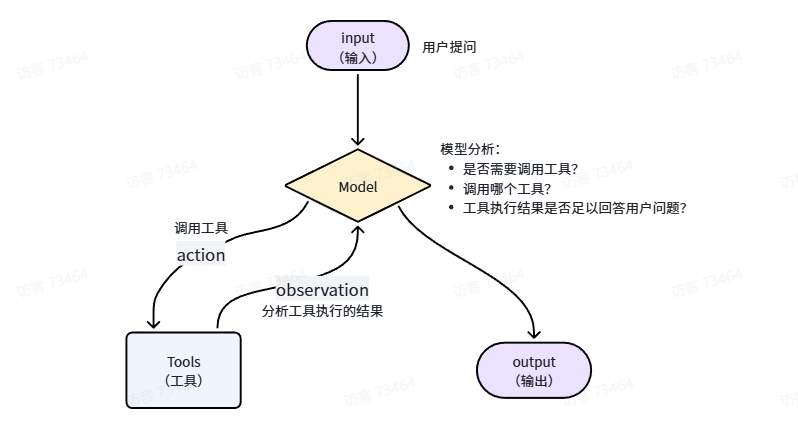
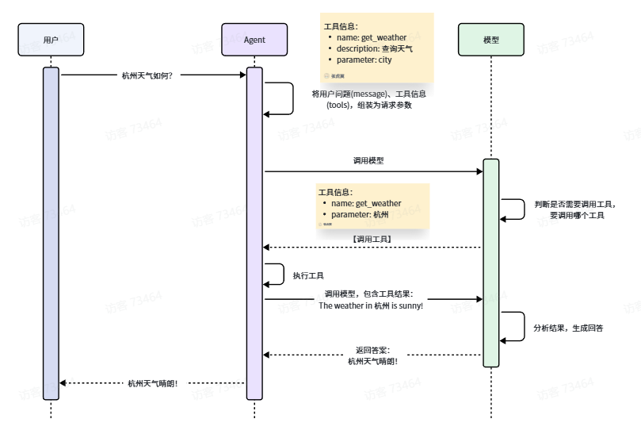
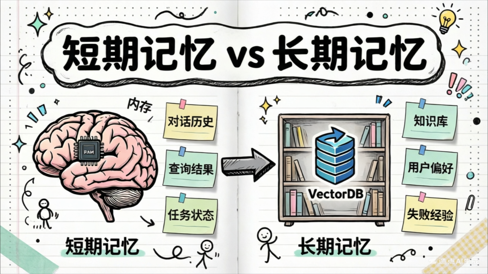

# Agents

## Agent概念
Agent=Model+Harness

+ Agent 是一个在循环中调用工具、直到任务完成的模型。紧随其后的推论才是关键
+ Harness（框架）是围绕Agent循环的一切：提示、工具，以及任何塑造模型行为的中间件。

## 创建Agent
create_agent 高度可配置 harness :

```python
from langchain.agents import create_agent

agent = create_agent(model="deepseek-flash", tools=tools, system_prompt="系统提示词")
```

> 基础参数：
>
> + 模型：model（模型标识符字符串 "provider:model"，或已初始化的模型实例）
> + 工具：tools （自定义工具）
> + 系统提示词：system_prompt（字符串或 SystemMessage)
>
> 进阶功能：
>
> + 通过middleware中间件扩展
>

## Model


## Tools
工具与模型的关系：



工具调用流程图：



## 结构化输出


## 短期记忆与长期记忆
短期记忆就是临时记忆，断电就没了；长期记忆就是永久记忆，持久保存。切勿被名字误导！！！

真实含义简单概括：

+ 短期记忆：当前任务或会话的上下文（Working Memory 或 Session Memory）
+ 长期记忆：跨任务或会话的经验与知识（Persistent Memory）



## AgentState


## checkpointer


## 流式输出


## 上下文管理


