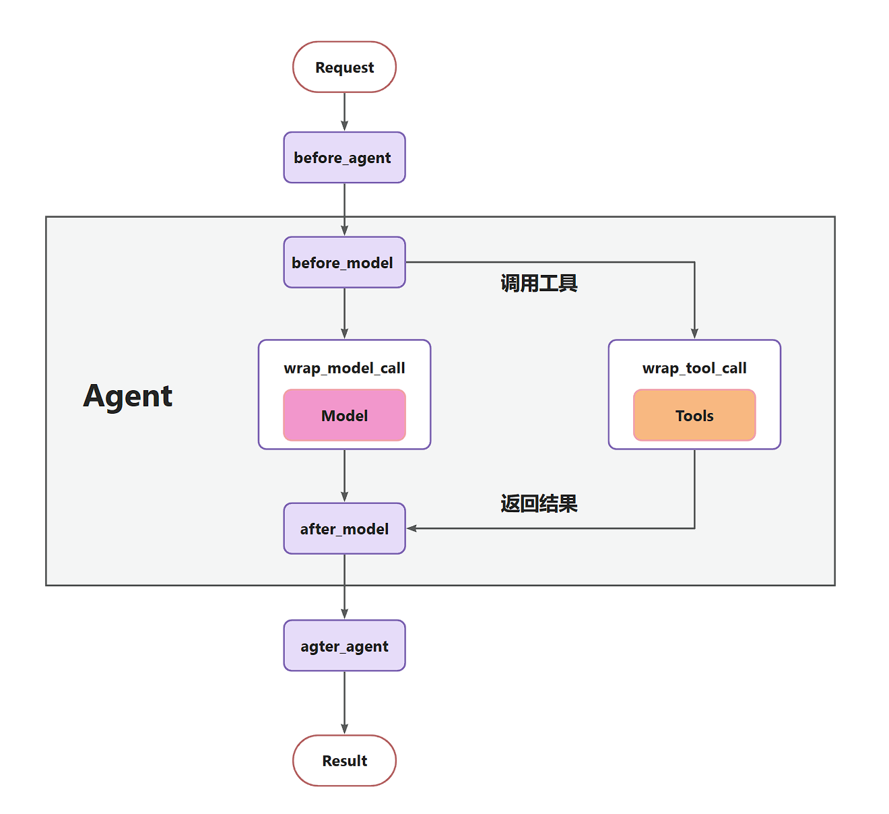

# Middleware 中间件

## 中间件嵌入执行流程



## 内置中间件

| Middleware 中间件（英 / 中） | 描述 |
| --- | --- |
| Tool error / 工具错误处理 | 捕获工具执行异常并将其转换为模型的错误消息 |
| Tool retry / 工具重试 | 自动以指数退避方式重试失败的工具调用 |
| Model retry / 模型重试 | 自动以指数退避方式重试失败的模型调用 |
| Model fallback / 模型降级兜底 | 在主模型失败时，自动切换到备选模型 |
| Model refusal / 模型拒绝处理 | 如果模型拒绝，则引发错误，而不是将拒绝视为最终答案 |
| Summarization / 对话摘要 | 在接近令牌限制时，自动总结对话历史记录 |
| Human-in-the-loop / 人工干预 | 暂停工具执行运行，等待人工批准 |
| Model call limit / 模型调用限制 | 限制模型调用的数量以防止成本过高 |
| Tool call limit / 工具调用限制 | 通过限制调用次数来控制工具执行 |
| PII detection / 个人敏感信息检测 | 检测和处理个人身份信息（PII） |
| To-do list / 任务清单 | 使代理具备任务规划和跟踪能力 |
| LLM tool selector / LLM 工具筛选器 | 在调用主模型前，使用 LLM 选择相关工具 |
| Model router / 模型路由 | 使用决策模型为每次代理运行选择合适的模型 |
| Auto mode / 自动安全管控 | 在工具运行前，使用决策模型阻止有风险的工具调用 |
| Provider tool search / 厂商服务端工具搜索 | 将工具委托给厂商的服务端工具搜索功能，按需展示 |
| Shell tool / Shell 工具 | 为代理暴露一个持久的 Shell 会话以执行命令 |
| Filesystem middleware / 文件系统中间件 | 为代理提供文件系统以存储上下文和长期记忆 |
| Subagent / 子代理 | 增加创建子代理的能力 |
| Rubric grading / 评分标准校验 | 应用 LLM-as-a-judge 评分机制，使代理自我评估并迭代直到满足评分标准 |
| File search / 文件搜索 | 提供针对文件系统文件的 Glob 与 Grep 搜索工具 |
| Context editing / 上下文编辑 | 通过裁剪或清理工具调用记录来管理对话上下文 |
| LLM tool emulator / LLM 工具模拟器 | 为测试目的，使用 LLM 模拟工具执行 |

## 自定义中间件

### (Hooks) 钩子类型

1. **节点式钩子**

| 节点式钩子 | When it runs 何时运行 |
| :---: | :---: |
| `before_agent` | Agent 启动前执行（每次调用仅运行一次） |
| `before_model` | 每一次模型调用前执行 |
| `after_model` | 每一次模型响应返回后执行 |
| `after_agent` | Agent 执行完成后执行（每次调用仅运行一次） |

2. **包裹式钩子**

| 包裹式钩子 | When it runs 运行范围 |
| :---: | :---: |
| `wrap_model_call` | 包裹每一次模型调用的全过程 |
| `wrap_tool_call` | 包裹每一次工具调用的全过程 |

**执行顺序：**

```python
agent = create_agent(
    model="gpt-6.1-sol",
    middleware=[middleware1, middleware2, middleware3],
    tools=[...],
)
```

* `before_*` 钩子：正序执行（1 → 2 → 3）
* `after_*` 钩子：倒序执行（3 → 2 → 1）
* `wrap_*` 钩子：嵌套执行（第一个中间件为最外层，包裹所有后续中间件）

**多中间件组合规则：**

当多个包裹式中间件都返回 `ExtendedModelResponse` 时，命令组合遵循三条规则：

1. 命令通过 Reducer 应用

* 每个 `Command` 触发一次独立的状态更新；对于消息字段，效果是累加的。

2. 冲突时外层优先

* 对于没有 reducer 的状态字段，命令按「内层先执行、外层后执行」的顺序应用；冲突的键以最外层中间件的值为准。

3. 重试安全

* 如果外层中间件实现了重试逻辑（多次调用 `handler()`），则较早调用产生的命令会被丢弃，仅保留最后一次有效调用的结果。

**最佳实践：**

1. 保持中间件专注 —— 每个中间件只做好一件事
2. 优雅处理错误 —— 不要让中间件异常导致 Agent 崩溃
3. 选用合适的钩子类型：

* 顺序逻辑（日志、校验）用节点式
* 控制流（重试、降级、缓存）用包裹式

4. 清晰文档化所有自定义状态字段
5. 集成前先对中间件做独立单元测试
6. 考虑执行顺序 —— 将关键中间件放在列表靠前位置
7. 优先使用内置中间件，避免重复造轮子

### 创建中间件

#### 基于装饰器创建中间件

| 分类 | 装饰器 | 说明 |
| --- | --- | --- |
| 节点式 | `@before_agent` | Agent 启动前运行 |
| 节点式 | `@before_model` | 每次模型调用前运行 |
| 节点式 | `@after_model` | 每次模型响应后运行 |
| 节点式 | `@after_agent` | Agent 完成后运行 |
| 包裹式 | `@wrap_model_call` | 包裹模型调用全过程 |
| 包裹式 | `@wrap_tool_call` | 包裹工具调用全过程 |
| 便捷装饰器 | `@dynamic_prompt` | 生成动态系统提示词 |

示例：

```python
from langchain.agents.middleware import before_model,wrap_model_call,AgentState,ModelRequest,ModelResponse
from langchain.agents import create_agent
from langgraph.runtime import Runtime
from typing import Any, Callable

@before_model
def log_before_model(state: AgentState, runtime: Runtime) -> dict[str, Any] | None:
    print(f"About to call model with {len(state['messages'])} messages")
    return None

@wrap_model_call
def retry_model(
    request: ModelRequest,
    handler: Callable[[ModelRequest], ModelResponse],
) -> ModelResponse:
    for attempt in range(3):
        try:
            return handler(request)
        except Exception as e:
            if attempt == 2:
                raise
            print(f"Retry {attempt + 1}/3 after error: {e}")

agent = create_agent(
    model="gpt-6.1-sol",
    middleware=[log_before_model, retry_model],
    tools=[...],
)

```

> 适用场景
>
> * 只需要单个钩子
> * 无需复杂配置参数
> * 快速原型开发

#### 基于类创建中间件

功能更强大，适合多钩子组合、需要配置参数、同时实现同步 / 异步版本的复杂场景。

三个核心类属性

`AgentMiddleware` 子类可声明三个类属性，在 Agent 编译时自动生效：

* `state_schema`：用自定义字段扩展 Agent 状态
* `tools`：注册中间件自带的附加工具（如待办清单中间件的 `write_todos`）
* `transformers`：注册作用域感知的流转换器工厂

示例：

```python
from langchain.agents.middleware import AgentMiddleware,AgentState,ModelRequest,ModelResponse,
from langgraph.runtime import Runtime
from typing import Any, Callable

class LoggingMiddleware(AgentMiddleware):
    def before_model(self, state: AgentState, runtime: Runtime) -> dict[str, Any] | None:
        print(f"About to call model with {len(state['messages'])} messages")
        return None

    def after_model(self, state: AgentState, runtime: Runtime) -> dict[str, Any] | None:
        print(f"Model returned: {state['messages'][-1].content}")
        return None

    async def abefore_model(
        self, state: AgentState, runtime: Runtime
    ) -> dict[str, Any] | None:
        # 异步版本
        return None

    async def aafter_model(
        self, state: AgentState, runtime: Runtime
    ) -> dict[str, Any] | None:
        # 异步版本
        print(f"Model returned: {state['messages'][-1].content}")
        return None

agent = create_agent(
    model="gpt-6.1-sol",
    middleware=[LoggingMiddleware()],
    tools=[...],
)

```

> 适用场景
>
> * 同一钩子需要同步 + 异步双实现
> * 单个中间件内需要多个钩子
> * 需要可配置的参数（阈值、模型实例等）
> * 跨项目复用，支持初始化配置

### 中间件操作

#### 更新State

两类钩子都可以更新 Agent 状态，但实现机制不同：

1. **节点式钩子更新**

直接返回一个字典，字典会通过图的 reducer（归约器）合并到 Agent 状态中。

```python
from langchain.agents.middleware import after_model, AgentState
from langgraph.runtime import Runtime
from typing import Any
from typing_extensions import NotRequired

class TrackingState(AgentState):
    model_call_count: NotRequired[int]

@after_model(state_schema=TrackingState)
def increment_after_model(state: TrackingState, runtime: Runtime) -> dict[str, Any] | None:
    return {"model_call_count": state.get("model_call_count", 0) + 1}
```

2. **包裹式钩子更新**

* 模型调用：返回 `ExtendedModelResponse`，内部携带 `Command` 对象，在模型响应的同时注入状态更新
* 工具调用：直接返回 `Command` 对象

适用于需要在调用过程中跟踪状态的场景，比如 Token 用量统计、摘要触发点标记等。

```python
from typing import Callable
from langchain.agents.middleware import  wrap_model_call,ModelRequest,ModelResponse,AgentState,ExtendedModelResponse

from langgraph.types import Command
from typing_extensions import NotRequired

class UsageTrackingState(AgentState):
    """带 Token 用量跟踪的 Agent 状态"""
    last_model_call_tokens: NotRequired[int]

@wrap_model_call(state_schema=UsageTrackingState)
def track_usage(
    request: ModelRequest,
    handler: Callable[[ModelRequest], ModelResponse],
) -> ExtendedModelResponse:
    response = handler(request)
    return ExtendedModelResponse(
        model_response=response,
        command=Command(update={"last_model_call_tokens": 150}),
    )
```

> `Command` 会流经图的 reducer 正确应用更新，消息字段是累加而非替换。

#### 自定义State模式

中间件可以扩展 Agent 的状态，添加自定义属性，实现：

* 跨执行跟踪状态：计数器、标志位等
* 钩子间共享数据：在 `before_model` 和 `after_model` 之间传递信息
* 横切关注点：限流、用量统计、审计日志等
* 条件决策：基于累积状态判断是否继续执行、跳转节点

> 为什么中间件中的 State 没有通过 state_schema 参数注册？
>
> * create_agent(state_schema=...)：定义的是基础状态模式 (Base Schema)。如果提供，它会替代默认的 AgentState 作为基底，再与所有中间件的 state_schema 合并。
> * 中间件 state_schema=...：定义的是该中间件专属的状态扩展。运行时，框架会收集所有中间件声明的 schema，并自动将它们合并到最终的状态中。

示例：

```python
from langchain.agents import create_agent
from langchain.messages import HumanMessage
from langchain.agents.middleware import AgentState, before_model, after_model
from typing_extensions import NotRequired
from typing import Any
from langgraph.runtime import Runtime

class CustomState(AgentState):
    model_call_count: NotRequired[int]
    user_id: NotRequired[str]

@before_model(state_schema=CustomState, can_jump_to=["end"])
def check_call_limit(state: CustomState, runtime: Runtime) -> dict[str, Any] | None:
    count = state.get("model_call_count", 0)
    if count > 10:
        return {"jump_to": "end"}
    return None

@after_model(state_schema=CustomState)
def increment_counter(state: CustomState, runtime: Runtime) -> dict[str, Any] | None:
    return {"model_call_count": state.get("model_call_count", 0) + 1}

agent = create_agent(
    model="gpt-6.1-sol",
    middleware=[check_call_limit, increment_counter],
    tools=[],
)

# 调用时传入自定义状态初始值
result = agent.invoke({
    "messages": [HumanMessage("Hello")],
    "model_call_count": 0,
    "user_id": "user-123",
})

```

> 只要某个字段已经在状态模式（state_schema）中定义过，无论它是通过 create_agent(state_schema=...) 还是通过中间件的 state_schema 声明的，都可以在 invoke 的输入中直接提供。
>
> 例如上述例子中直接提供了"model_call_count"和"user_id"字段
>
> result = agent.invoke({
>
> ```
> "messages": [HumanMessage("Hello")],
>
> "model_call_count": 0,
>
> "user_id": "user-123",
> ```
>
> })

#### 自定义流 Transformers

中间件可以注册流转换器工厂，将实时代理流中的事件投影到自定义扩展通道，用于输出计数器、旁路数据、部分结果或底层脱敏，无需耦合框架内置投影。

核心规则

* 编译时，中间件注册的转换器会与调用者直接传入的转换器合并
* 排序规则：内置转换器（如 `ToolCallTransformer`）排在最前，调用者传入的排在最后
* 每个工厂接收 `scope` 作用域元组（根为空元组，子图为非空），返回新的转换器实例，保证子图隔离

具体实例参考 `stream_events事件流` 中的 `自定义流 Transformers` 章节

#### jump_to 跳转

在节点式钩子中，返回带 `jump_to` 的字典可让 Agent 跳转到指定节点，实现提前终止等逻辑。

可用跳转目标

* `'end'`：跳转到 Agent 执行终点，进入 `after_agent` 流程
* `'tools'`：跳转到工具执行节点
* `'model'`：跳转到模型调用节点

示例：

```python
from langchain.agents.middleware import after_model, hook_config, AgentState
from langchain.messages import AIMessage
from langgraph.runtime import Runtime
from typing import Any

@after_model
@hook_config(can_jump_to=["end"])
def check_for_blocked(state: AgentState, runtime: Runtime) -> dict[str, Any] | None:
    last_message = state["messages"][-1]
    if "BLOCKED" in last_message.content:
        return {
            "messages": [AIMessage("I cannot respond to that request.")],
            "jump_to": "end"
        }
    return None
```

#### 配置追踪

> 这是一个专门针对 LangSmith 追踪器（LangSmithTracer） 设计的配置项。

中间件钩子默认会追踪输入和输出的完整负载。通过 `trace_policy` 可以控制追踪记录的内容，作为性能优化手段。

`TracePolicy` 支持 `process_inputs`、`process_outputs` 、 `omit_payload`

* process_inputs：转换输入再记录
* process_outputs：转换输出再记录
* omit_payload：干脆什么都不记

中间件级配置：

```python
from langchain.agents.middleware import AgentMiddleware, TracePolicy, omit_payload

class MyMiddleware(AgentMiddleware):
    trace_policy = TracePolicy(process_inputs=omit_payload)
```

全局默认配置：

```python
from langchain.agents.middleware import configure_trace_policy, TracePolicy, omit_payload

configure_trace_policy(TracePolicy(process_inputs=omit_payload))
# 传入 None 可清除全局配置
```

> 中间件自身的 `trace_policy` 优先级高于全局默认值。

### 官方示例

#### 动态提示词

最常用的中间件场景之一：在每次模型调用前动态修改系统提示，注入上下文、用户专属指令。

> 核心要点：`ModelRequest.system_message` 始终是 `SystemMessage` 对象，即使 Agent 是用字符串 `system_prompt` 创建的。推荐使用 `content_blocks` 操作内容，追加新块以保留原有结构。

```python
from collections.abc import Callable
from langchain.agents.middleware import ModelRequest, ModelResponse, wrap_model_call
from langchain.messages import SystemMessage

@wrap_model_call
def add_context(
    request: ModelRequest,
    handler: Callable[[ModelRequest], ModelResponse],
) -> ModelResponse:
    new_content = list(request.system_message.content_blocks) + [
        {"type": "text", "text": "Additional context."}
    ]
    new_system_message = SystemMessage(content=new_content)
    return handler(request.override(system_message=new_system_message))
```

#### 动态模型选择

根据对话复杂度自动切换模型。

```python
from collections.abc import Callable
from langchain.agents.middleware import ModelRequest, ModelResponse, wrap_model_call
from langchain.chat_models import init_chat_model

complex_model = init_chat_model("claude-sonnet-4-6")
simple_model = init_chat_model("claude-haiku-4-5-20251001")

@wrap_model_call
def dynamic_model(
    request: ModelRequest,
    handler: Callable[[ModelRequest], ModelResponse],
) -> ModelResponse:
    if len(request.messages) > 10:
        model = complex_model
    else:
        model = simple_model
    return handler(request.override(model=model))
```

#### 动态选择工具

运行时筛选相关工具，缩短提示、提升准确率、实现权限控制。

```python
from langchain.agents import create_agent
from langchain.agents.middleware import wrap_model_call, ModelRequest, ModelResponse
from typing import Callable

@wrap_model_call
def select_tools(
    request: ModelRequest,
    handler: Callable[[ModelRequest], ModelResponse],
) -> ModelResponse:
    """基于状态和上下文筛选相关工具"""
    relevant_tools = select_relevant_tools(request.state, request.runtime)
    return handler(request.override(tools=relevant_tools))

agent = create_agent(
    model="gpt-6.1-sol",
    tools=all_tools,  # 所有工具需预先注册
    middleware=[select_tools],
)
```

#### 工具调用监控

记录所有工具调用的名称、参数与执行结果。

```python
from collections.abc import Callable
from langchain.agents.middleware import wrap_tool_call
from langchain.messages import ToolMessage
from langchain.tools.tool_node import ToolCallRequest
from langgraph.types import Command

@wrap_tool_call
def monitor_tool(
    request: ToolCallRequest,
    handler: Callable[[ToolCallRequest], ToolMessage | Command],
) -> ToolMessage | Command:
    print(f"Executing tool: {request.tool_call['name']}")
    print(f"Arguments: {request.tool_call['args']}")
    try:
        result = handler(request)
        print("Tool completed successfully")
        return result
    except Exception as e:
        print(f"Tool failed: {e}")
        raise
```
