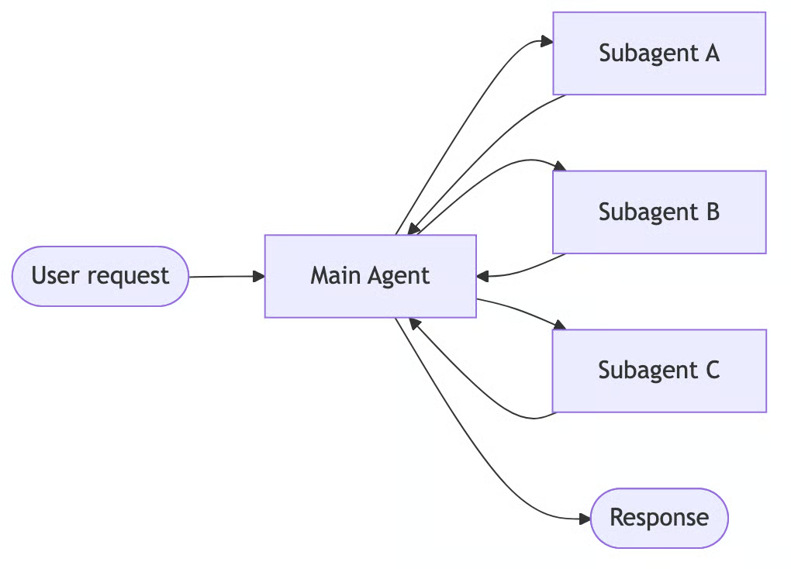
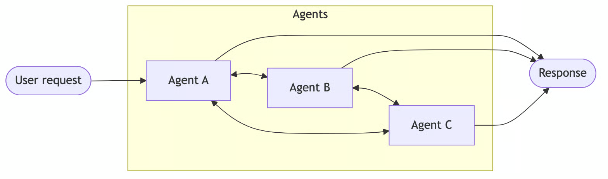
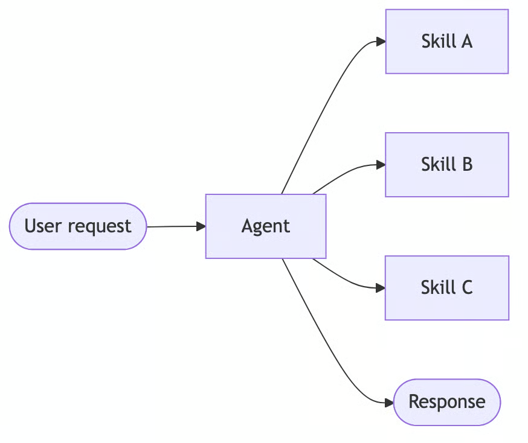
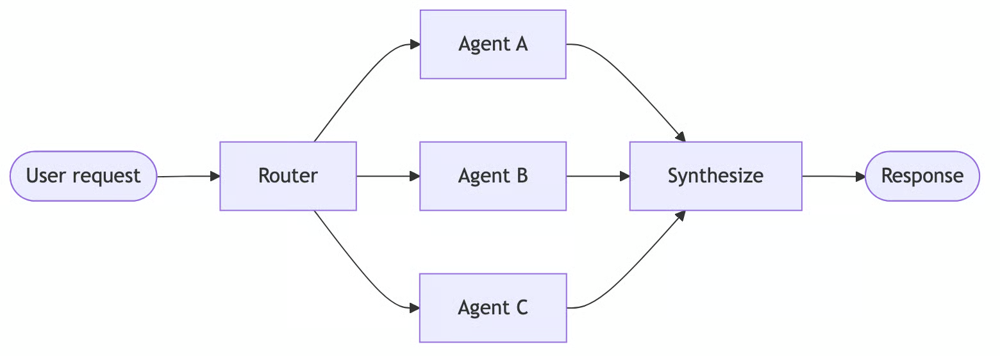

# Multi Agent

## 常见 Multi Agent
| Pattern 模式 | 分布式协同开发 | 任务并行化 | 多轮跳转 | 用户直接交互 |
| --- | --- | --- | --- | --- |
| Subagents | ⭐⭐⭐⭐⭐ | ⭐⭐⭐⭐⭐ | ⭐⭐⭐⭐⭐ | ⭐ |
| Handoffs | - | - | ⭐⭐⭐⭐⭐ | ⭐⭐⭐⭐⭐ |
| Skills | ⭐⭐⭐⭐⭐ | ⭐⭐⭐ | ⭐⭐⭐⭐⭐ | ⭐⭐⭐⭐⭐ |
| Router | ⭐⭐⭐ | ⭐⭐⭐⭐⭐ | - | ⭐⭐⭐ |

## Subagents：子代理模式

## Handoffs：传递模型

## Skills：技能模式

## Router：路由模式

