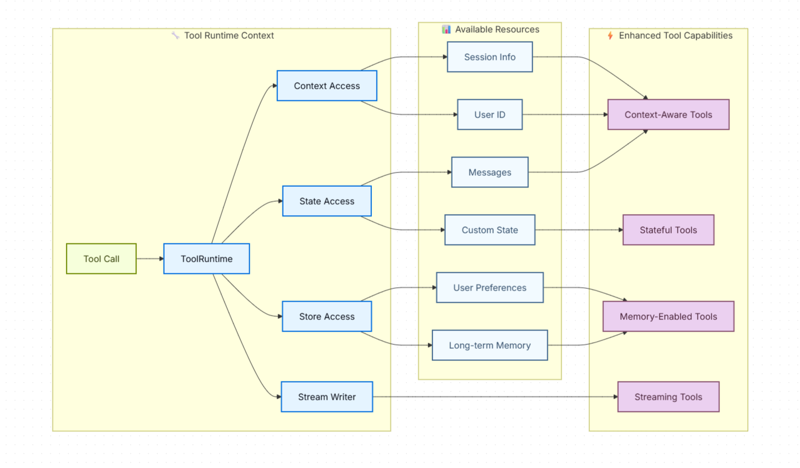

# Tools 工具

## 创建Tools

### 自定义tools

```python
# 自定义工具名称 + description工具描述
@tool("calculator", description="Performs arithmetic calculations. Use this for any math problems.")
def calc(expression: str) -> str:
    """Evaluate mathematical expressions."""
    return str(eval(expression))

# 创建智能体，并绑定工具
agent = create_agent(
    model="deepseek-chat",
    tools=[get_weather]
)
```

> 注意：
>
> * 默认工具名等于函数名，可以通过装饰器参数自定义更贴切的名称
> * 可以使用 description 参数手动覆盖自动生成的描述，给模型更明确的调用指引

### 高级 Schema 定义

#### Pydantic model

Pydantic模型是复杂输入参数更推荐的方式：

```python
from pydantic import BaseModel, Field
from typing import Literal

class WeatherInput(BaseModel):
    """Input for weather queries."""
    location: str = Field(description="City name or coordinates")
    units: Literal["celsius", "fahrenheit"] = Field(
        default="celsius",
        description="Temperature unit preference"
    )
    include_forecast: bool = Field(
        default=False,
        description="Include 5-day forecast"
    )

@tool(args_schema=WeatherInput)
def get_weather(location: str, units: str = "celsius", include_forecast: bool = False) -> str:
    """Get current weather and optional forecast."""
    temp = 22 if units == "celsius" else 72
    result = f"Current weather in {location}: {temp} degrees {units[0].upper()}"
    if include_forecast:
        result += "\nNext 5 days: Sunny"
    return result
```

#### JSON Schema

```python
weather_schema = {
    "type": "object",
    "properties": {
        "location": {"type": "string"},
        "units": {"type": "string"},
        "include_forecast": {"type": "boolean"}
    },
    "required": ["location", "units", "include_forecast"]
}

@tool(args_schema=weather_schema)
def get_weather(location: str, units: str = "celsius", include_forecast: bool = False) -> str:
    """Get current weather and optional forecast."""
    temp = 22 if units == "celsius" else 72
    result = f"Current weather in {location}: {temp} degrees {units[0].upper()}"
    if include_forecast:
        result += "\nNext 5 days: Sunny"
    return result
```

## Runtime context（运行时上下文）

**如何访问 Runtime：**

1. 工具中使用runtime
   * 直接注入ToolRuntime
2. 中间件中使用runtime
   * 节点式钩子（node-style）：如 `@before_model`、`@after_model`，直接通过第二个参数接收 Runtime 对象
   * 包装式钩子（wrap-style）：如 `@dynamic_prompt`、`@wrap_model_call`，通过 `request.runtime` 访问

### 上下文组件列表

工具的强大之处在于可以访问对话历史、用户数据、持久化记忆等运行时信息。所有这些能力都通过 `ToolRuntime` 参数提供，该参数会自动注入到工具中，并且对大模型不可见（不会出现在工具 Schema 里）。

| 组件 | 说明 | 典型场景 |
| --- | --- | --- |
| **State** | 短期记忆：当前对话内的动态可变数据（消息、计数器、自定义字段） | 访问对话历史、统计工具调用次数 |
| **Store** | 长期记忆：保存跨会话需要复用的数据 | 保存用户偏好、维护知识库 |
| **Context** | 不可变配置：调用时传入的静态信息（用户 ID、会话信息） | 根据用户身份个性化回复 |
| **Stream Writer** | 用于通过  custom  流模式输出自定义流式信息 | 长耗时任务展示执行进度 |
| **Execution Info** | 当前执行的身份与重试信息（线程 ID、运行 ID、尝试次数） | 获取线程 / 运行 ID、根据重试次数调整行为 |
| **Server Info** | LangGraph Server 环境下的服务端元数据（助手 ID、图 ID、认证用户） | 获取部署标识、读取当前登录用户信息 |
| **Config** | 执行配置 RunnableConfig | 访问回调、标签、元数据 |
| **Tool Call ID** | 当前工具调用的唯一标识 | 日志关联、调用追踪 |



### \*\*State \*\*短期记忆

State 一个贯穿整轮对话的共享字典，所有节点（包括工具）都能读写它。

State的边界是thread_id。

定义并注册AgentState：

```python
# 默认 schema：只有 messages（AgentState中的默认字段）
# 如果需要自定义字段，就继承AgentState扩展：
class CustomState(AgentState):
    user_name: str
    user_preferences: dict

# 注册State
agent = create_agent(
    model="deepseek-flash",
    tools=[set_user_name],
    state_schema=CustomState,
)
```

读取状态：

```python
# 读取内置message字段
@tool
def get_last_user_message(runtime: ToolRuntime) -> str:
    messages = runtime.state["messages"]          # messages 是内置的
    for m in reversed(messages):
        if isinstance(m, HumanMessage):
            return m.content
    return "No user messages found"

# 读取自定义字段
@tool
def get_user_preference(pref_name: str, runtime: ToolRuntime) -> str:
    prefs = runtime.state.get("user_preferences", {})
    return prefs.get(pref_name, "Not set")
```

更新状态：

```python
@tool
def set_user_name(new_name: str, runtime: ToolRuntime[None, CustomState]) -> Command:
    return Command(
        update={
            "user_name": new_name,                     # 1. 改自定义字段
            "messages": [                              # 2. 必须回执 ToolMessage
                ToolMessage(
                    content=f"User name set to {new_name}.",
                    tool_call_id=runtime.tool_call_id, # 3. 对上调用 ID
                )
            ],
        }
    )
```

> 为什么要返回 Command？
>
> 因为工具执行完要把"结果"反馈给模型，同时修改状态。Command.update 是一个字典：
>
> * "user_name": new_name —— 更新自定义字段；
> * "messages": \[ToolMessage(...)] —— 必须塞入一条 ToolMessage作为工具调用的结果，否则模型不知道工具干了什么

### \*\*Store \*\*长期记忆

`BaseStore` 提供跨会话的持久化存储，数据不会随对话结束而消失。

存储采用「命名空间 + 键」的组织模式，生产环境推荐使用 `PostgresStore`，开发测试可以用内存版 `InMemoryStore`。

```python
from typing import Any
from langgraph.store.memory import InMemoryStore
from langchain.agents import create_agent
from langchain.tools import tool, ToolRuntime

# 读取长期记忆
@tool
def get_user_info(user_id: str, runtime: ToolRuntime) -> str:
    """Look up user info."""
    store = runtime.store
    user_info = store.get(("users",), user_id)
    return str(user_info.value) if user_info else "Unknown user"

# 写入长期记忆
@tool
def save_user_info(user_id: str, user_info: dict[str, Any], runtime: ToolRuntime) -> str:
    """Save user info."""
    store = runtime.store
    store.put(("users",), user_id, user_info)
    return "Successfully saved user info."

# 初始化存储并绑定到 Agent
store = InMemoryStore()
agent = create_agent(model, tools=[get_user_info, save_user_info], store=store)

# 会话1：保存用户信息
agent.invoke({"messages": [{"role": "user", "content": "Save user abc123: name Foo, age 25"}]})

# 会话2：跨会话读取用户信息
agent.invoke({"messages": [{"role": "user", "content": "Get info for user abc123"}]})

```

### Context 上下文

Context 是调用时传入的**不可变配置数据**，比如用户 ID、会话信息、业务配置，在整个对话过程中不会改变，该上下文会贯穿本次 Agent 运行的全流程。

Context 中的数据默认不会自动发给大模型；只有代码主动读取并把内容加入提示词或工具结果时，模型才会看到它。

```python
from dataclasses import dataclass
from langchain_openai import ChatOpenAI
from langchain.agents import create_agent
from langchain.tools import tool, ToolRuntime


USER_DATABASE = {
    "user123": {"name": "Alice Johnson", "account_type": "Premium", "balance": 5000}
}

@dataclass
class UserContext:
    user_id: str

@tool
def get_account_info(runtime: ToolRuntime[UserContext]) -> str:
    """Get the current user's account information."""
    # 根据用户id获取用户信息
    user_id = runtime.context.user_id
    if user_id in USER_DATABASE:
        user = USER_DATABASE[user_id]
        return f"Account holder: {user['name']}\nType: {user['account_type']}\nBalance: ${user['balance']}"
    return "User not found"


model = ChatOpenAI(model="gpt-4.1")
agent = create_agent(
    model,
    tools=[get_account_info],
    context_schema=UserContext,
    system_prompt="You are a financial assistant."
)


result = agent.invoke(
    {"messages": [{"role": "user", "content": "What's my current balance?"}]},
    context=UserContext(user_id="user123") # 构造context
)
```

### Stream writer  流写入器

用于通过 `custom` 流模式输出自定义流式信息

> 前提：
>
> * 只有用 graph.stream(...) / graph.astream(...) 运行 agent 时，这条流才有"接收方"。如果直接用 graph.invoke(...)（不 stream），或者脱离 graph 单独调用工具，writer() 发出去的数据没人接收，可能直接报错或丢弃。
> * stream_writer用于给用户/前端进度反馈。不进 messages，模型完全无感。要让模型知道结果，必须 return 或 Command 里放 ToolMessage。

```python
from langchain.tools import tool, ToolRuntime

@tool
def get_weather(city: str, runtime: ToolRuntime) -> str:
    """Get weather for a given city."""
    writer = runtime.stream_writer

    writer(f"Looking up data for city: {city}")     # ① 开始时的播报
    # ... 可能耗时的实际逻辑 ...
    writer(f"Acquired data for city: {city}")       # ② 中间/结束前的播报

    return f"It's always sunny in {city}!"          # ③ 最终结果给模型
```

在调用 agent 的一侧，需要指定 stream_mode="custom"：

```python
async for chunk in graph.astream(
    {"messages": [HumanMessage("北京天气怎么样？")]},
    stream_mode="custom",        # 👈 关键：接收 writer 发的自定义流
):
    print(chunk)   # 会依次打印 "Looking up data..."、"Acquired data..."
```

### Execution info  执行信息

通过 `runtime.execution_info` 可以在工具内部获取当前执行的线程 ID、运行 ID 和节点重试次数，用于日志埋点、幂等控制、重试降级等场景。

```python
from langchain.tools import tool, ToolRuntime

@tool
def log_execution_context(runtime: ToolRuntime) -> str:
    """Log execution identity information."""
    info = runtime.execution_info
    print(f"Thread: {info.thread_id}, Run: {info.run_id}")
    print(f"Attempt: {info.node_attempt}")
    return "done"
```

核心字段：

* `thread_id`：对话线程 ID，对应会话持久化的唯一标识
* `run_id`：本次运行的唯一 ID，用于全链路追踪
* `node_attempt`：当前节点的重试次数，可用于实现重试降级、熔断逻辑

### Server info  服务器信息

当工具运行在 **LangGraph Server** 部署环境中时，可以通过 `runtime.server_info` 获取服务端的部署元数据与认证用户信息；本地开发 / 测试环境下该字段为 `None`。

```python
from langchain.tools import tool, ToolRuntime

@tool
def get_assistant_scoped_data(runtime: ToolRuntime) -> str:
    """Fetch data scoped to the current assistant."""
    server = runtime.server_info
    if server is not None:
        print(f"Assistant: {server.assistant_id}, Graph: {server.graph_id}")
        if server.user is not None:
            print(f"User: {server.user.identity}")
    return "done"
```

核心字段：

* `assistant_id`：当前部署的助手 ID
* `graph_id`：当前运行的工作流图 ID
* `user`：已认证的用户信息，包含 `identity` 字段，未配置认证时为 `None`

> 注意：本地运行时 `server_info` 为 `None`，使用前必须做空值判断

## Tool execution（工具执行）

### 工具返回值

#### 返回 string

返回人类可读的纯文本，模型会基于文本继续推理。

* 行为：返回值会被包装为 `ToolMessage`，不直接修改状态

```python
from langchain.tools import tool

@tool
def get_weather(city: str) -> str:
    """Get weather for a city."""
    return f"It is currently sunny in {city}."
```

#### 返回 object

返回结构化数据（如字典），模型可以直接读取字段进行推理。

* 行为：对象会被序列化后作为工具输出，不直接修改状态

```python
from langchain.tools import tool

@tool
def get_weather_data(city: str) -> dict:
    """Get structured weather data for a city."""
    return {
        "city": city,
        "temperature_c": 22,
        "conditions": "sunny",
    }
```

#### 返回 command

当工具需要修改图状态时，返回 `Command` 对象，必须附带匹配当前调用的 `ToolMessage`。

* 行为：通过 `update` 字段更新状态，更新后同一次运行的后续步骤立即可见

```python
from langchain.messages import ToolMessage
from langchain.tools import ToolRuntime, tool
from langgraph.types import Command

@tool
def set_language(language: str, runtime: ToolRuntime) -> Command:
    """Set the preferred response language."""
    return Command(
        update={
            "preferred_language": language,
            "messages": [
                ToolMessage(
                    content=f"Language set to {language}.",
                    tool_call_id=runtime.tool_call_id,    #  tool call ID 需匹配当前工具调用
                )
            ],
        }
    )

# =======================前提：状态定义=================================
class MyState(TypedDict):
    preferred_language: str
    messages: Annotated[list, add_messages]

# 状态定义通过 state_schema 参数注入给 Graph 或 Agent
agent = create_agent(..., state_schema=MyState, tools=[set_language])
```

#### 返回多模态内容

支持返回文本、图片等多模态内容，需要对应模型支持多模态工具结果。

* 行为：返回值会被包装为多模态 `ToolMessage`

```python
from langchain.tools import tool

@tool
def capture_screenshot() -> list[dict]:
    """Capture a screenshot of the current page."""
    return [
        {"type": "text", "text": "Screenshot of the current page:"},
        {"type": "image", "url": "https://example.com/page.png"},
    ]
```

#### 直接返回 return_direct

给工具设置 `return_direct=True` 后，工具执行完成后会直接作为最终结果返回，不再经过模型处理，跳过额外的模型调用。

* 并行调用场景下，只有**所有被调用的工具都开启了 `return_direct=True`**，才会直接终止流程返回结果
* 如果混合了普通工具和 `return_direct` 工具，流程会回到模型继续推理
* 适用场景：工具输出就是最终答案、需要确定性输出、避免额外模型开销

```python
from langchain.agents import create_agent
from langchain.tools import tool
from langchain_openai import ChatOpenAI

@tool(return_direct=True)
def fetch_order_status(order_id: str) -> str:
    """Fetch the current status of a customer order."""
    return f"Order {order_id} is shipped and will arrive in 2 days."

agent = create_agent(
    ChatOpenAI(model="gpt-5.4-mini"),
    tools=[fetch_order_status],
)

result = agent.invoke({
    "messages": [{"role": "user", "content": "What is the status of order #12345?"}]
})
```

#### command + return_direct

开启 `return_direct` 的工具也可以返回 `Command`，在退出 Agent 循环前更新状态，同样需要附带 `ToolMessage`。

```python
from langchain.messages import ToolMessage
from langchain.tools import ToolRuntime, tool
from langgraph.types import Command

@tool(return_direct=True)
def fetch_and_store_order(order_id: str, runtime: ToolRuntime) -> Command:
    """Fetch order status and store it in state."""
    status = f"Order {order_id} is shipped and will arrive in 2 days."
    return Command(
        update={
            "last_order_status": status,
            "messages": [
                ToolMessage(
                    content=status, 
                    tool_call_id=runtime.tool_call_id
                )
            ],
        }
    )
```

### 错误处理

通过 `wrap_tool_call` 中间件捕获工具执行异常，将异常转换为模型可理解的 `ToolMessage`，支持不同模型厂商。

```python
from collections.abc import Callable
from langchain.agents import create_agent
from langchain.agents.middleware import wrap_tool_call
from langchain.messages import ToolMessage
from langchain.tools.tool_node import ToolCallRequest

@wrap_tool_call
def handle_tool_errors(
    request: ToolCallRequest,
    handler: Callable[[ToolCallRequest], ToolMessage],
) -> ToolMessage:
    """Convert tool exceptions into ToolMessages the model can handle."""
    try:
        return handler(request)
    except Exception as e:
        return ToolMessage(
            content=f"Tool error: Please check your input and try again. ({e})",
            tool_call_id=request.tool_call["id"],
        )

agent = create_agent(
    model="openai:gpt-5.5",
    tools=[],
    middleware=[handle_tool_errors],
)
```

### 状态注入

工具通过 `ToolRuntime` 访问图状态，`ToolNode` 会自动完成状态注入，无需手动处理。

```python
from langchain.tools import tool, ToolRuntime
from langgraph.prebuilt import ToolNode

@tool
def get_message_count(runtime: ToolRuntime) -> str:
    """Get the number of messages in the conversation."""
    messages = runtime.state["messages"]
    return f"There are {len(messages)} messages."
```

## 动态工具选择

动态工具选择指在运行时动态调整 Agent 可用的工具集，避免工具过多导致模型上下文过载，同时适配权限、功能开关、对话阶段等场景。

### 过滤预注册工具

所有工具在 Agent 创建时预先注册，运行时根据条件过滤可用工具，支持三种判断维度：

1. 基于对话状态（State）。根据对话进度、认证状态等动态启用 / 禁用工具：

```python
from langchain.agents import create_agent, AgentState
from typing import NotRequired

class CustomState(AgentState):          # 继承默认 AgentState，保留 messages 等
    authenticated: NotRequired[bool]    # 新增自定义字段（NotRequired 让初始可不提供）

@wrap_model_call
def state_based_tools(
    request: ModelRequest,
    handler: Callable[[ModelRequest], ModelResponse]
) -> ModelResponse:
    """根据会话state筛选工具"""
    # Read from State: check if user has authenticated
    state = request.state
    is_authenticated = state.get("authenticated", False)
    message_count = len(state["messages"])

    # Only enable sensitive tools after authentication
    if not is_authenticated:
        tools = [t for t in request.tools if t.name.startswith("public_")]
        request = request.override(tools=tools)
    elif message_count < 5:
        # Limit tools early in conversation
        tools = [t for t in request.tools if t.name != "advanced_search"]
        request = request.override(tools=tools)

    return handler(request)
    
agent = create_agent(
    model="gpt-5.5",
    tools=[public_search, private_search, advanced_search],
    middleware=[state_based_tools],
    state_schema=CustomState,           # ← 关键：把自定义状态注册进去
)
```

2. 基于长期存储（Store）。根据用户偏好、功能开关过滤工具：

```python
from dataclasses import dataclass
from langchain.agents import create_agent
from langchain.agents.middleware import wrap_model_call, ModelRequest, ModelResponse
from typing import Callable
from langgraph.store.memory import InMemoryStore

@dataclass
class Context:
    user_id: str

@wrap_model_call
def store_based_tools(
    request: ModelRequest,
    handler: Callable[[ModelRequest], ModelResponse]
) -> ModelResponse:
    """根据store偏好筛选工具。"""
    user_id = request.runtime.context.user_id
    store = request.runtime.store
    # 以 user_id 为键，到 ("features",) 这个命名空间下查找
    feature_flags = store.get(("features",), user_id)

    if feature_flags:
        enabled_features = feature_flags.value.get("enabled_tools", [])
        tools = [t for t in request.tools if t.name in enabled_features]
        request = request.override(tools=tools)
    return handler(request)

agent = create_agent(
    model="gpt-5.5",
    tools=[search_tool, analysis_tool, export_tool],
    middleware=[store_based_tools],
    context_schema=Context,
    store=InMemoryStore()
)

```

3. 基于运行时上下文（Context）。根据用户角色、权限控制工具可用性：

```python
from dataclasses import dataclass
from langchain.agents import create_agent
from langchain.agents.middleware import wrap_model_call, ModelRequest, ModelResponse
from typing import Callable

@dataclass
class Context:
    user_role: str

@wrap_model_call
def context_based_tools(
    request: ModelRequest,
    handler: Callable[[ModelRequest], ModelResponse]
) -> ModelResponse:
    """Filter tools based on Runtime Context permissions."""
    # Read from Runtime Context: get user role
    if request.runtime is None or request.runtime.context is None:
        # If no context provided, default to viewer (most restrictive)
        user_role = "viewer"
    else:
        user_role = request.runtime.context.user_role

    if user_role == "admin":
        # Admins get all tools
        pass
    elif user_role == "editor":
        # Editors can't delete
        tools = [t for t in request.tools if t.name != "delete_data"]
        request = request.override(tools=tools)
    else:
        # Viewers get read-only tools
        tools = [t for t in request.tools if t.name.startswith("read_")]
        request = request.override(tools=tools)

    return handler(request)

agent = create_agent(
    model="gpt-5.5",
    tools=[read_data, write_data, delete_data],
    middleware=[context_based_tools],
    context_schema=Context
)
```

### 运行时工具注册

当工具在运行时才被发现（如从 MCP 服务器加载、根据用户数据生成），需要通过两个中间件钩子实现：

1. `wrap_model_call`：向模型请求中添加动态工具
2. `wrap_tool_call`：处理动态工具的执行逻辑

```python
from langchain.tools import tool
from langchain.agents import create_agent
from langchain.agents.middleware import AgentMiddleware, ModelRequest, ToolCallRequest

# ─────────────────────────────────────────────────────────────
# 定义一个"运行时才注入"的工具
# 注意：它既没写进 create_agent(tools=[...])，也没在别处注册
# ─────────────────────────────────────────────────────────────
@tool
def calculate_tip(bill_amount: float, tip_percentage: float = 20.0) -> str:
    """Calculate the tip amount for a bill."""        # docstring 会被当成工具描述发给模型
    tip = bill_amount * (tip_percentage / 100)         # 计算小费金额
    return f"Tip: ${tip:.2f}, Total: ${bill_amount + tip:.2f}"   # 返回格式化结果


# ─────────────────────────────────────────────────────────────
# 自定义中间件：负责在"模型调用前"和"工具调用时"动态挂载该工具
# ─────────────────────────────────────────────────────────────
class DynamicToolMiddleware(AgentMiddleware):

    # 钩子 1：模型调用之前
    # request: 本次模型请求的上下文（包含已注册的工具列表 tools）
    # handler: 下游处理函数，调用它才会真正发起模型请求
    def wrap_model_call(self, request: ModelRequest, handler):
        # 通过 override 复制出一个新请求，把 calculate_tip 追加进工具列表
        # 效果：模型在本次调用中"看到"了这个工具，因此可能发起对它的 tool_call
        updated = request.override(tools=[*request.tools, calculate_tip])
        return handler(updated)                        # 把修改后的请求交给下游

    # 钩子 2：模型返回 tool_call、真正执行工具时
    # request: 本次工具调用的请求（含 tool_call 名称、参数等）
    def wrap_tool_call(self, request: ToolCallRequest, handler):
        # 如果模型要调用的是我们动态加的 calculate_tip……
        if request.tool_call["name"] == "calculate_tip":
            # ……就用 override 把"实际执行的工具实现"替换成 calculate_tip
            # （因为 Agent 的静态注册表里没有它，必须在这里补上实现）
            return handler(request.override(tool=calculate_tip))
        # 其它工具（如 get_weather）走原路径，不做改动
        return handler(request)


# ─────────────────────────────────────────────────────────────
# 创建 Agent
# ─────────────────────────────────────────────────────────────
agent = create_agent(
    model="gpt-5.5",                 # 使用的模型
    tools=[get_weather],             # 只静态注册 get_weather，calculate_tip 不在其中
    middleware=[DynamicToolMiddleware()],   # 挂上中间件 → 运行时把 calculate_tip 动态注入
)
```

> 工程上泛化：一个中间件管理一批动态工具
>
> 最直接的做法，是把“动态工具集合”作为中间件的构造参数，而不是硬编码。

## 官方预制工具集

[工具集成](https://docs.langchain.com/oss/python/integrations/tools)
