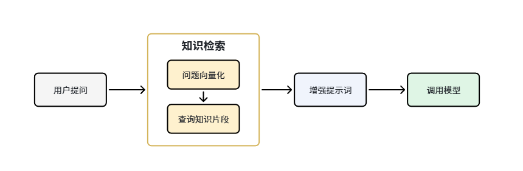

# 检索增强优化

## 知识检索 Agent 架构
| 架构 | 介绍 | 可控性 | 拓展性 | 延迟 | 场景 |
| --- | --- | --- | --- | --- | --- |
| 2-Step RAG | 每次调用模型前都做知识检索，流程简单、可控 | ✅ High | ❌ Low | ⚡ Fast | FAQs, 文档问答机器人 |
| Agentic RAG | 由 LLM 来思考何时进行知识检索 | ❌ Low | ✅ High | ⏳ Variable | 绑定了很多工具的研究助手 |
| Hybrid | 结合两种方式的特点，并加入答案验证环节 | ⚖️ Medium | ⚖️ Medium | ⏳ Variable | 对回答质量要求非常高的特殊领域 |


### 2-Step RAG


把RAG的流程固化为两步：

1. Retrieve：检索知识库，返回知识片段
2. Generate：增强生成，基于知识片段增强Prompt和用户问题，调用模型生成答案

简单来说：就是每次发送请求给LLM之前，都修改提示词，拼接检索到的知识片段。

> 在LangChain中，提供了一个@dynamic_prompt装饰器，用来实现动态修改提示词。
>

```python
from langchain.agents.middleware import dynamic_prompt, ModelRequest
from langchain.chat_models import init_chat_model
from dotenv import load_dotenv
load_dotenv()

# 0.定义动态提示词中间件
@dynamic_prompt
def rag_prompt(request: ModelRequest):
    # 1.拿到用户问题，也就是消息列表中的最后一条消息
    print("================User Message================")
    user_input = request.state['messages'][-1].text
    print(user_input, "\n")

    # 2.检索知识片段, list[Document], 拼接为字符串
    docs = vector_store.similarity_search(user_input, k=2)
    context = "\n\n".join(doc.page_content for doc in docs)
    print('=============== Context ====================')
    print(context, "\n")

    # 3.拼接新系统提示词
    return f'''
    你是一个教资考试专家，你根据上下文回答用户问题，不能自己编造答案。答案要简短，直接引用原文。
    Context: {context}
    '''
# 1.初始化模型
model = init_chat_model(
    "deepseek-v4-flash",
    extra_body={'thinking': {'type': 'disabled'}}
)

# 2.定义Agent
agent = create_agent(
    model,
    middleware=[rag_prompt],
)
```

### Agentic RAG
Agent自主决定何时检索、检索什么、用不用其他工具。实现方式就是将检索器包装为Tool，Agent可以自主判合适调用工具来获取文档，甚至是多次检索，多轮迭代。

| ******好处** | ******缺点** |
| --- | --- |
| 只在需要时搜索 —LLM 可以处理问候、跟进和简单查询，而不会触发不必要的搜索。 | 两次 LLM 调用 —— 在执行搜索时，需要一个调用生成查询，另一个调用生成最终响应。 |
| 上下文搜索查询 - 通过将检索作为 “查询” 的工具，LLM 可以根据会话上下文的自定义查询。 | 可能失控 - LLM 可能在实际需要时跳过搜索，或者在不必要时发出额外的搜索。 |
| 允许多次搜索 - LLM 可以执行多个搜索来寻找答案。 | |


```python
from langchain_core.tools import tool
from langchain.chat_models import init_chat_model
from langchain.agents import create_agent
# ================Agentic RAG===================

# 1.加载环境变量
from dotenv import load_dotenv
load_dotenv()

# 2.初始化模型
model = init_chat_model(
    "deepseek-flash",
    extra_body = {"thinking": {"type": "disabled"}}
)

# 3.定义工具
@tool
def retrieve_docs(query: str):
    """检索知识库，获取与用户提问相关的知识片段"""

    # 1.根据问题检索知识片段
    documents = vector_store.similarity_search(query)

    # 2.拼接知识片段
    context = "\n".join([doc.page_content for doc in documents])

    return context

# 4.定义Agent，绑定model和Tool
agent = create_agent(
    model,
    tools=[retrieve_docs],
    system_prompt="你是一个教资考试专家，回答与教资相关问题时，必须调用工具检索文档，根据文档回答用户的问题，不能自己编造答案。答案要简短，直接引用原文。"
)
```


## 检索优化
### 查询优化
#### 查询重写


#### 虚构文档嵌入


#### 问题拆分


### 检索优化
#### 稠密检索


#### 稀疏检索


#### 混合检索


### 重排序
#### MMR


#### Cross-Encoder


### 综合示例


